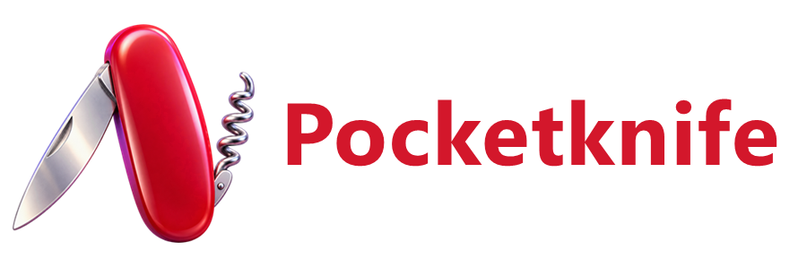
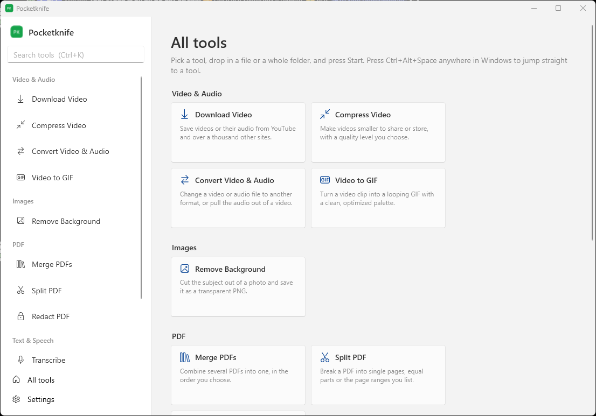
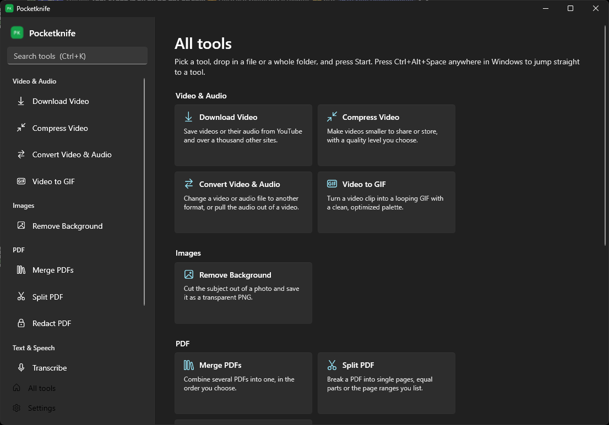
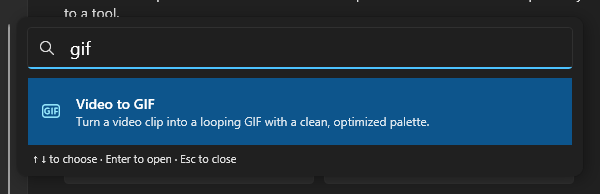
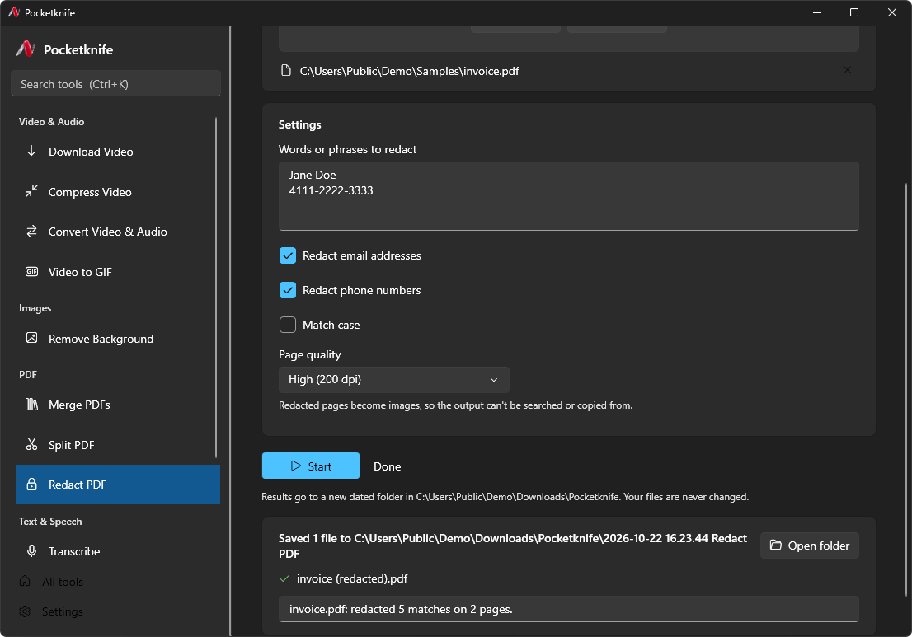
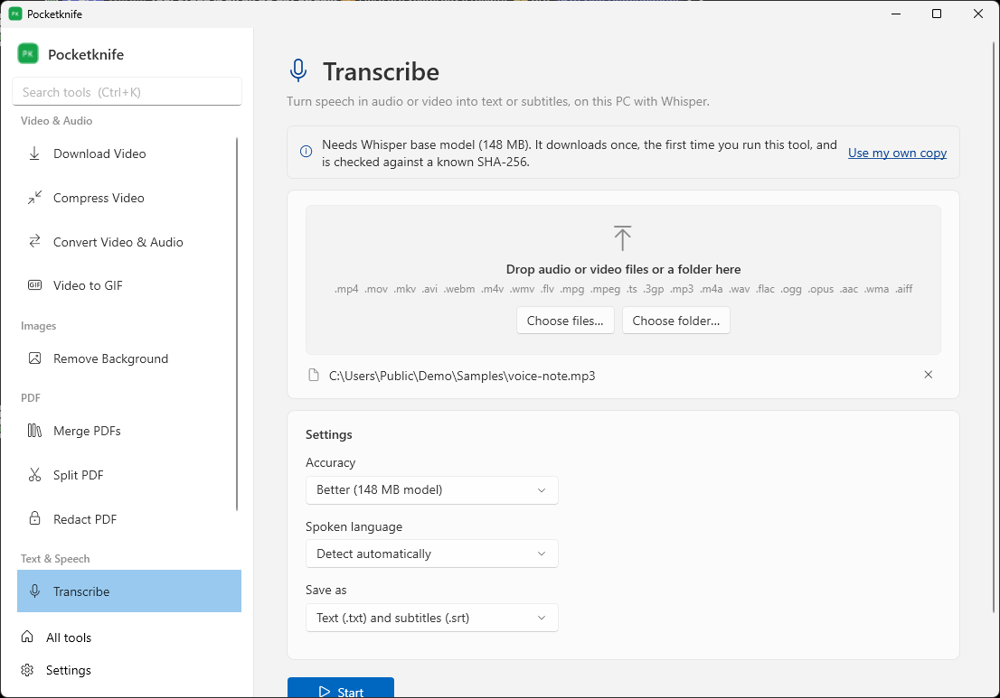
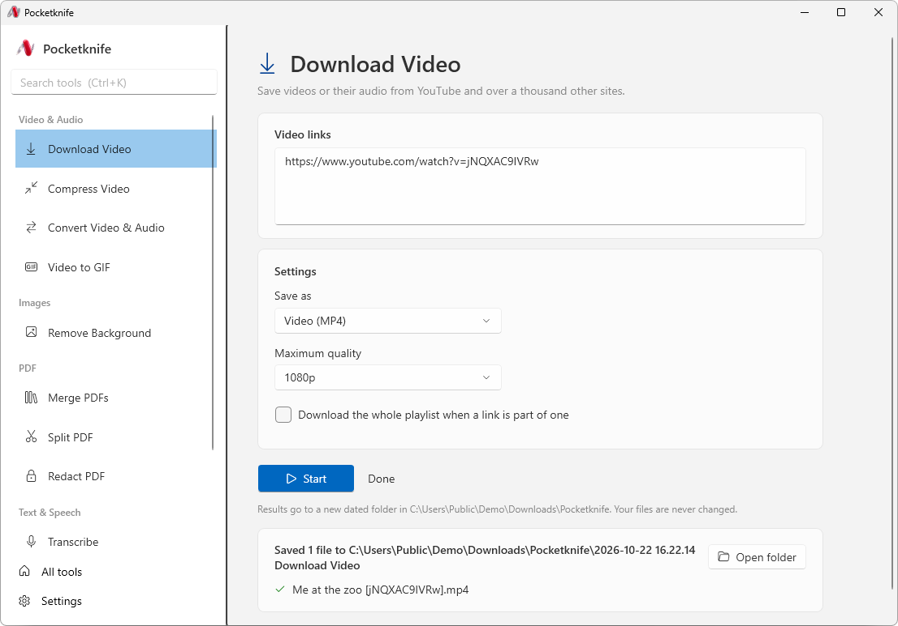
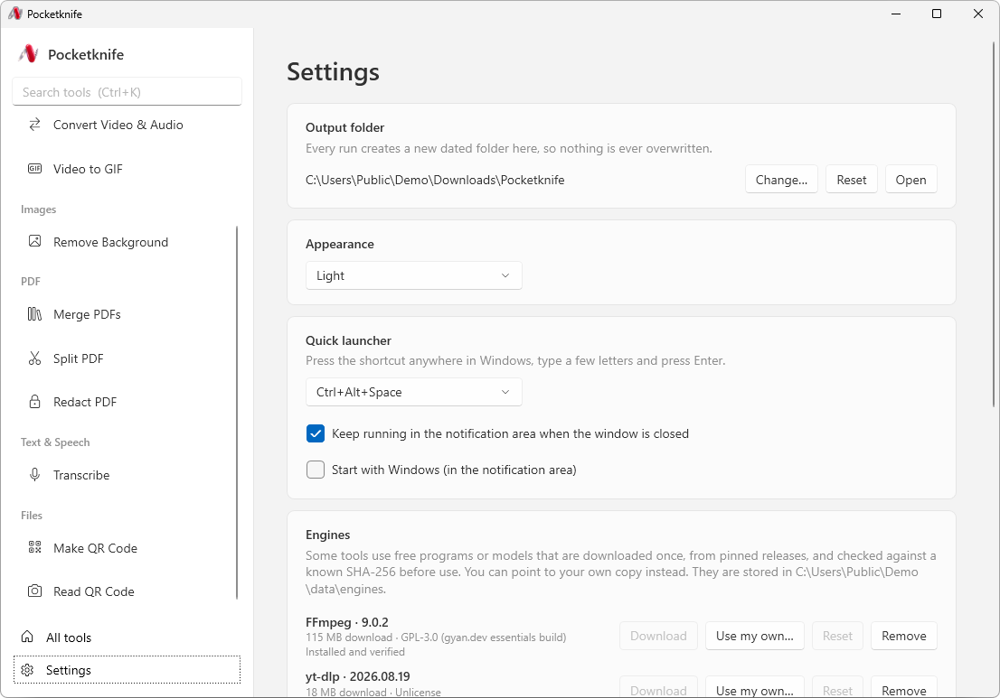
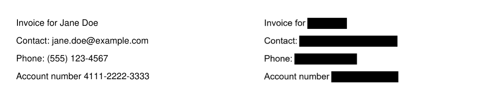

<p align="center">
  <a href="https://github.com/kenhendricks00/Pocketknife/releases"></a>
</p>
<div align="center">
  <a href="https://github.com/kenhendricks00/Pocketknife/releases">
    </a>
  <a href="LICENSE">
    </a>
  <a href="https://github.com/kenhendricks00/Pocketknife/commits/main/">
    </a>
</div>
<br>
<h2> <div align="center"><b> A PC multitool for Windows. Everyday file tools that run on your PC, with no account and no uploads. </b></div> </h2>

<p align="center">


</p>

# 🛠️ Usage
Open a tool, drop in a file or a whole folder, pick the few settings that tool needs, and press <code>Start</code>. Results go to a **new dated folder** in <code>Downloads\Pocketknife</code>, for example <code>2026-10-22 14.05.31 Compress Video</code>. Your original files are never changed and nothing is ever overwritten.

> [!TIP]
> Press <code>Ctrl+Alt+Space</code> anywhere in Windows, type a few letters (<code>gif</code>, <code>redact</code>, <code>qr</code>…) and press <code>Enter</code> to jump straight to a tool. The shortcut can be changed in Settings.

<p align="center">

</p>

**Tools:**

| Tool | What it does | Runs on |
| --- | --- | --- |
| **Download Video** | Save videos or just their audio (MP4, MP3, M4A) from YouTube and other sites, one link per line | yt-dlp + FFmpeg |
| **Compress Video** | Smaller MP4 (H.264 or H.265) with a quality level and optional max resolution | FFmpeg |
| **Convert Video & Audio** | MP4, WebM, MOV, MKV, MP3, M4A, WAV, FLAC or OGG, including pulling the audio out of a video | FFmpeg |
| **Video to GIF** | Looping GIF with an optimized palette, with width, frame rate, start and length | FFmpeg |
| **Remove Background** | Transparent PNG cutout of the subject in a photo | ONNX Runtime + IS-Net / U²-Net |
| **Merge PDFs** | Combine PDFs in the order you set | Built in |
| **Split PDF** | One file per page, files of N pages, or page ranges like <code>1-3, 5, 8-</code> | Built in |
| **Redact PDF** | Black out words, emails and phone numbers for good, then flatten pages and strip metadata | Built in |
| **Transcribe** | Speech in audio or video to <code>.txt</code> and <code>.srt</code> subtitles, in 17 languages or auto-detect | Whisper (whisper.cpp) |
| **Make QR Code** | QR codes as PNG or SVG, one per line if you like | Built in |
| **Read QR Code** | Read the text or link from QR codes in screenshots and photos | Built in |

Every tool that takes files also takes a folder. All of its matching files are processed in one run, and a file that fails is reported without stopping the rest.

# 🌟 Why Choose Pocketknife?
- **Private by design**: Every tool runs on your PC, including transcription and background removal. There is no account, no analytics and no uploads.
- **One screen per tool**: Each tool shows only the settings it needs, so there is nothing to learn.
- **Safe with your files**: Inputs are opened read-only, and every run writes to its own new folder, so nothing is overwritten.
- **Batch ready**: Drop a folder and every matching file is processed in one go.
- **True PDF redaction**: Pages are rebuilt as images with the matches painted black, so the hidden text, fonts and metadata are gone, not just covered.
- **Feels like Windows**: Native Fluent design that follows your light or dark mode, with a system-wide launcher and a notification-area icon.
- **Verified engines**: FFmpeg, yt-dlp and the AI models download once from pinned releases and must match a known SHA-256 before they are used.

# 📋 Key Features
1. **Quick launcher**:
    - <code>Ctrl+Alt+Space</code> from any app, type to filter, <code>Enter</code> to open.
    - Search understands names, initials (<code>cv</code> → Compress Video) and keywords (<code>youtube</code>, <code>subtitles</code>, <code>black out</code>).
2. **Batch processing**:
    - Drop files or folders onto any tool, or choose them with the file and folder pickers.
    - Merge PDFs lets you reorder files before merging.
3. **Output you can trust**:
    - A new dated folder per run under <code>Downloads\Pocketknife</code> (or a folder you choose in Settings).
    - Partial files from a failed or cancelled job are removed, and finished files are kept.
4. **Local AI**:
    - **Transcribe** uses Whisper through whisper.cpp, with a *Better* (148 MB) or *Faster* (78 MB) model.
    - **Remove Background** uses IS-Net (*Best quality*, 179 MB) or U²-Net small (*Fast*, 5 MB) through ONNX Runtime.
5. **Bring your own engines**:
    - Point Settings at your own <code>ffmpeg.exe</code>, <code>yt-dlp.exe</code> or model files instead of the managed downloads.
6. **Runs in the background**:
    - Closing the window keeps the launcher available from the notification area. Optionally start with Windows.
7. **Command line**:
    - <code>Pocketknife.exe --tool compress-video "C:\Videos\clip.mp4"</code> opens a tool with inputs filled in. <code>--launcher</code> opens the launcher and <code>--background</code> starts in the notification area.

<p align="center">


</p>
<p align="center">


</p>
<p align="center">

</p>
<p align="center">

</p>

# 🔒 Privacy
Pocketknife never sends your files anywhere. It only uses the network for two things:
- **Download Video** fetches the links you paste.
- **First use of an engine** downloads it from the pinned release listed below. You can skip this by pointing Settings at your own copy.

There is no telemetry, no crash reporting and no update check.

# ⚙️ Engines
Engines are stored in <code>%LOCALAPPDATA%\Pocketknife\engines</code>. They are not bundled with the app.

| Engine | Pinned version | License | Used by |
| --- | --- | --- | --- |
| [FFmpeg](https://ffmpeg.org) ([gyan.dev](https://www.gyan.dev/ffmpeg/builds/) essentials build) | 9.0.2 | GPL-3.0 | Video & audio tools, Transcribe |
| [yt-dlp](https://github.com/yt-dlp/yt-dlp) | 2026.08.19 | Unlicense | Download Video |
| [Whisper](https://github.com/openai/whisper) ggml models via [whisper.cpp](https://github.com/ggml-org/whisper.cpp) | base, tiny | MIT | Transcribe |
| [IS-Net](https://github.com/xuebinqin/DIS) and [U²-Net](https://github.com/xuebinqin/U-2-Net) ONNX models | isnet-general-use, u2netp | Apache-2.0 | Remove Background |

# 🚀 Install
Download the latest release from the [Releases page](https://github.com/kenhendricks00/Pocketknife/releases):
- **Installer**: <code>Pocketknife-&lt;version&gt;-win-x64-setup.exe</code> installs for your user only (no admin needed) and adds a Start menu entry.
- **Portable**: <code>Pocketknife-&lt;version&gt;-win-x64-portable.zip</code>. Unzip anywhere and run <code>Pocketknife.exe</code>.

Requires 64-bit Windows 10 (version 2004 or later) or Windows 11. The .NET runtime is included. The builds aren't code-signed yet, so Windows SmartScreen may ask you to confirm the first launch.

# 🧑‍💻 Build From Source
You need the [.NET 10 SDK](https://dotnet.microsoft.com/download). [Inno Setup 6](https://jrsoftware.org/isinfo.php) is optional, for the installer.

```powershell
dotnet build Pocketknife.slnx
dotnet test --project tests/Pocketknife.Tests   # downloads the engines once into %LOCALAPPDATA%\Pocketknife-tests
dotnet format Pocketknife.slnx --verify-no-changes
./scripts/package.ps1                          # release/ portable zip, installer and SHA256SUMS.txt
./scripts/ui-smoke.ps1 -Exe artifacts/publish/Pocketknife.exe -Work $env:TEMP/pocketknife-smoke -Screenshots $env:TEMP/pocketknife-shots
```

<code>ui-smoke.ps1</code> drives the real app through UI Automation, runs every tool on the test fixtures, presses the launcher hotkey and checks that the input files were not changed.

**Adding a tool** means writing one class that derives from <code>Tool</code> (see <code>src/Pocketknife.Core/Tools</code>) and listing it in <code>ToolRegistry</code>. The class declares its input, its settings and the engines it needs, and the app builds its screen from that.

# 💬 Support
If you need help or found a bug, open an [issue on GitHub](https://github.com/kenhendricks00/Pocketknife/issues).

# 🎉 Quick Links
- [Download the latest release](https://github.com/kenhendricks00/Pocketknife/releases)
- [Report a bug or request a tool](https://github.com/kenhendricks00/Pocketknife/issues/new/choose)
- [Star the source code on GitHub](https://github.com/kenhendricks00/Pocketknife)

# 📜 Credits
- Built with [.NET](https://dotnet.microsoft.com) and WPF with the Fluent theme
- PDF reading and writing by [PdfPig](https://github.com/UglyToad/PdfPig), page rendering by Windows' built-in PDF engine
- QR codes by [ZXing.Net](https://github.com/micjahn/ZXing.Net)
- Speech recognition by [Whisper.net](https://github.com/sandrohanea/whisper.net) and [whisper.cpp](https://github.com/ggml-org/whisper.cpp)
- Background removal on [ONNX Runtime](https://onnxruntime.ai) with [IS-Net](https://github.com/xuebinqin/DIS) and [U²-Net](https://github.com/xuebinqin/U-2-Net)
- Video and audio by [FFmpeg](https://ffmpeg.org) and [yt-dlp](https://github.com/yt-dlp/yt-dlp)

Full license texts are in [THIRD-PARTY-NOTICES.md](THIRD-PARTY-NOTICES.md).

# License

Copyright (c) 2026 Kenneth Hendricks.

Pocketknife is licensed under the [MIT License](LICENSE). Bundled libraries are MIT or Apache-2.0. FFmpeg (GPL) and yt-dlp are downloaded separately at first use and run as separate programs, so they are not part of this app's distribution.
